# 📊 Beszel

Guia de instalação do **Beszel**, um monitor de servidores leve: um painel web (hub) recebe dos agentes o uso de CPU, memória, disco, rede, temperatura e o consumo de cada container Docker, guarda o histórico e envia alertas.

---

## Conteúdo

- [Como funciona](#como-funciona)
- [Estrutura do repositório](#estrutura-do-repositório)
- [1. Subir o hub e o agente local](#1-subir-o-hub-e-o-agente-local)
- [2. Conectar o agente local](#2-conectar-o-agente-local)
- [3. Monitorar outros servidores](#3-monitorar-outros-servidores)
- [Publicar o hub com domínio (Nginx Proxy Manager)](#publicar-o-hub-com-domínio-nginx-proxy-manager)
- [Alertas](#alertas)
- [Comandos do dia a dia](#comandos-do-dia-a-dia)
- [Problemas comuns](#problemas-comuns)
- [Recursos adicionais](#recursos-adicionais)

---

## Como funciona

| Parte | O que faz | Porta |
|---|---|---|
| **Hub** | Painel web, histórico, usuários e alertas | `8090` |
| **Agente** | Coleta as métricas do servidor e dos containers e envia ao hub | `45876` (só no modo SSH) |

Com `HUB_URL` e `TOKEN`, o **agente abre a conexão de saída** até o hub (WebSocket). Assim, os servidores monitorados não precisam de nenhuma porta liberada para fora.

---

## Estrutura do repositório

| Arquivo | Para que serve |
|---|---|
| `docker-compose.yml` | Hub + agente do próprio servidor, ligados por um socket Unix |
| `.env.example` | Endereço do hub, token e chave do agente local |
| `agente/docker-compose.yml` | Agente para instalar em cada servidor remoto |
| `agente/.env.example` | Endereço do hub, token e chave do agente remoto |

---

## 1. Subir o hub e o agente local

```bash
git clone https://github.com/Jarderl/Beszel.git
cd Beszel
cp .env.example .env
nano .env                 # ajuste APP_URL e TZ
docker compose up -d beszel
```

Abra `http://IP_DO_SERVIDOR:8090` e crie a conta de administrador.

---

## 2. Conectar o agente local

1. No hub, clique em **Add System**.
2. Em **Host / IP**, informe `/beszel_socket/beszel.sock` (o socket compartilhado com o agente local).
3. Copie os valores de **KEY** e **TOKEN** do diálogo para `AGENT_KEY` e `AGENT_TOKEN` no `.env`.
4. Suba o agente e confirme no diálogo:

```bash
docker compose up -d beszel-agent
```

O servidor aparece na tabela. **Verde** significa conectado.

---

## 3. Monitorar outros servidores

No hub, clique em **Add System** e informe o IP do servidor remoto. Depois, nesse servidor:

```bash
git clone https://github.com/Jarderl/Beszel.git
cd Beszel/agente
cp .env.example .env
nano .env                 # HUB_URL, AGENT_TOKEN e AGENT_KEY do diálogo
docker compose up -d
```

Sem Docker no servidor remoto, o script oficial instala o agente como serviço (ele pede a chave, o token e o endereço do hub):

```bash
curl -sL https://get.beszel.dev -o /tmp/install-agent.sh && chmod +x /tmp/install-agent.sh && sudo /tmp/install-agent.sh
```

Para ligar vários servidores sem cadastrar um por um, gere um **token universal** em **Settings → Tokens** e use o mesmo token em todos os agentes.

---

## Publicar o hub com domínio (Nginx Proxy Manager)

1. Em **Hosts → Proxy Hosts → Add Proxy Host**:
   - Domain Names: `monitor.seudominio.com.br`
   - Forward Hostname: IP do servidor do hub · Forward Port: `8090`
   - Marque **Websockets Support** (os agentes remotos conectam por WebSocket)
   - Em **SSL**: certificado Let's Encrypt e **Force SSL**
2. No `.env` do hub, troque `APP_URL` para `https://monitor.seudominio.com.br` e rode `docker compose up -d`.
3. Nos agentes remotos, use esse mesmo endereço em `HUB_URL`.

Com o hub publicado no domínio, feche a porta 8090 para fora no firewall do servidor.

---

## Alertas

Em cada servidor da tabela, o ícone de sino define os limites: CPU, memória, disco, temperatura, largura de banda e **servidor fora do ar**. Os destinos dos avisos (e-mail ou URLs de notificação para Telegram, Discord, ntfy e outros serviços) ficam em **Settings → Notifications**.

---

## Comandos do dia a dia

```bash
docker compose ps                     # Estado do hub e do agente
docker compose logs -f beszel-agent   # Logs do agente (erros de conexão aparecem aqui)
docker compose pull && docker compose up -d   # Atualiza hub e agente
```

O histórico fica em `./beszel_data`: copie essa pasta para fazer backup do hub.

---

## Problemas comuns

- **Servidor vermelho na tabela**: veja `docker compose logs beszel-agent`. Em geral é `KEY`/`TOKEN` trocados ou `HUB_URL` errado.
- **Agente remoto não conecta pelo domínio**: falta marcar **Websockets Support** no proxy host do NPM.
- **Tráfego de rede zerado**: o agente precisa de `network_mode: host`.
- **Containers não aparecem**: falta montar `/var/run/docker.sock` no agente.

---

## Recursos adicionais

- [Documentação do Beszel](https://beszel.dev/guide/getting-started)
- [Instalação do agente](https://beszel.dev/guide/agent-installation)
- [Repositório oficial](https://github.com/henrygd/beszel)
